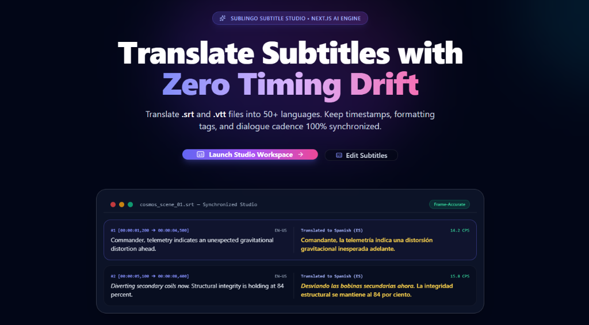
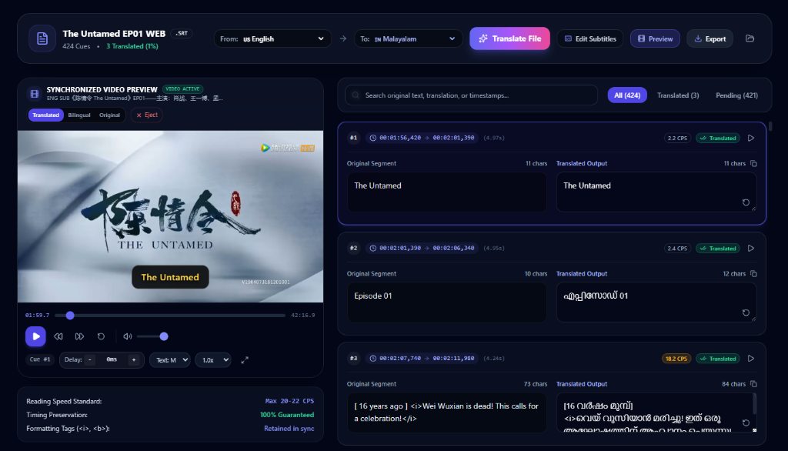
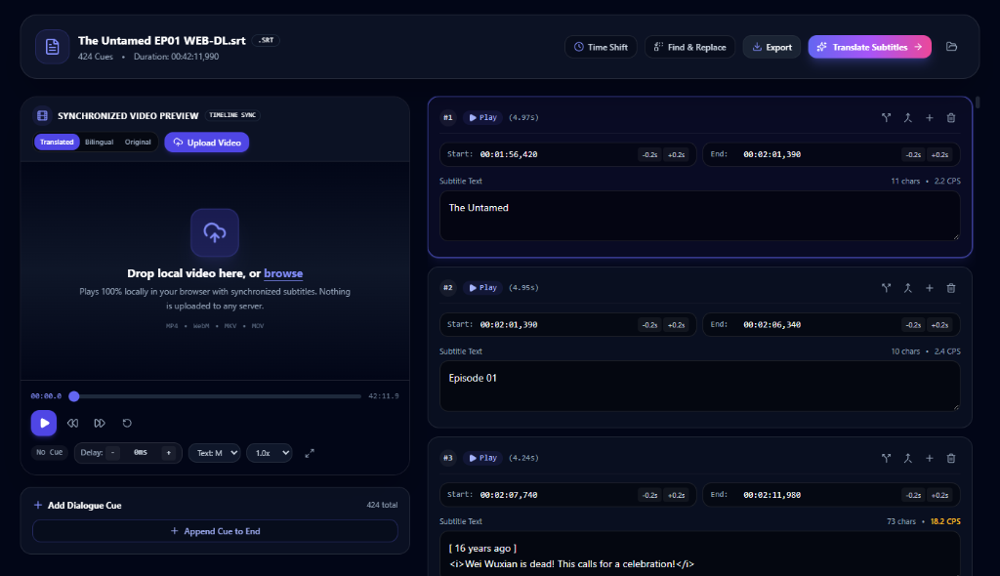
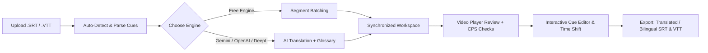

<div align="center">

  <h1>SubLingo</h1>

  <h3>AI Subtitle Translation & Frame-Accurate Timing Studio</h3>

  <p align="center">
    Translate, retarget, edit, and synchronize <strong>SRT</strong> and <strong>WebVTT</strong> subtitle files with zero timing drift, intelligent reading speed metrics, and multi-engine AI localization.
  </p>

  <p align="center">
    <a href="https://nextjs.org/"></a>
    <a href="https://react.dev/"></a>
    <a href="https://www.typescriptlang.org/"></a>
    <a href="https://tailwindcss.com/"></a>
    <a href="https://vitest.dev/"></a>
  </p>

  <p align="center">
    <a href="#overview">Overview</a> •
    <a href="#studio-interfaces">Studio Interfaces</a> •
    <a href="#core-capabilities">Core Capabilities</a> •
    <a href="#translation-engines">AI Translation Engines</a> •
    <a href="#studio-workflow">Studio Workflow</a> •
    <a href="#getting-started">Getting Started</a> •
    <a href="#environment-variables">Configuration</a> •
    <a href="#api-reference">API Reference</a>
  </p>

  <br />

  

  <br /><br />

</div>

---

## Overview

Subtitling is one of the most fragile steps in video post-production. Translating subtitle tracks using general-purpose translators frequently destroys caption pacing:

1. **Timestamp Drift:** LLMs and web translators often merge, delete, or hallucinate cue boundaries, making subtitles display out of sync with the audio track.
2. **Excessive Reading Speed:** Translated dialogue in romance or Germanic languages often inflates character counts, causing subtitles to flash on screen faster than human viewers can read.
3. **Lost Formatting Tags:** Crucial stylistic markers such as `<i>` (off-screen dialogue/voiceover), `<b>`, and WebVTT cue placement headers (`align:middle`, `line:0%`) are stripped or mangled.

**SubLingo** is engineered specifically to eliminate these points of failure. By decoupling subtitle timestamp structures from translation payloads, SubLingo translates dialogue while locking timecodes to the exact millisecond. It pairs intelligent translation with a real-time synchronized video player, Characters-Per-Second (CPS) readability checking, a full cue timeline editor, and multi-format bilingual export.

---

## Studio Interfaces

<table>
  <tr>
    <td width="50%" align="center" valign="top">
      <h3>🌐 Translate Workspace</h3>
      <p align="left">
        High-throughput batch translation studio with simultaneous video playback, cue status tracking, Characters-Per-Second (CPS) pace indicators, and real-time translation verification.
      </p>
      
      <ul align="left">
        <li><strong>Multi-Engine AI:</strong> One-click translation with Gemini, GPT-4o, DeepL, or the free built-in engine.</li>
        <li><strong>Synchronized Video Overlay:</strong> Instant playback of subtitles against local video files or simulated tracks.</li>
        <li><strong>CPS Speed Alerts:</strong> Dynamic character-per-second monitoring to prevent unreadable fast dialogue.</li>
      </ul>
    </td>
    <td width="50%" align="center" valign="top">
      <h3>✂️ Subtitle Editor</h3>
      <p align="left">
        Precision subtitle manipulation workspace featuring interactive cue splitting, continuous merging, global millisecond retiming, and global search & replace.
      </p>
      
      <ul align="left">
        <li><strong>Non-Destructive Retiming:</strong> Split long lines into balanced cues or merge contiguous segments.</li>
        <li><strong>Global Time Shifting:</strong> Move all cue start/end points forward or backward by custom millisecond offsets.</li>
        <li><strong>Search & Replace:</strong> Rapidly update terms, character names, or terminology across all cues.</li>
      </ul>
    </td>
  </tr>
</table>

---

## Core Capabilities

### ⏱️ Frame-Accurate Millisecond Synchronization
SubLingo treats subtitle timecodes as immutable anchors.
- **Microsecond Precision:** Converts timestamp formats (`HH:MM:SS,mmm` in SRT and `HH:MM:SS.mmm` / `MM:SS.mmm` in WebVTT) into floating-point seconds during parsing and preserves time spans across translation runs.
- **Tag & Punctuation Preservation:** Retains inline HTML formatting (`<i>`, `<b>`, `<u>`) and subtitle break conventions across translations without corrupting styling.
- **Zero Hallucination of Cue IDs:** Subtitle blocks are isolated in bounded data structures so that the output count always matches the input count 1:1.

### 📊 Reading Speed (CPS) Readability Guard
Subtitles that disappear too quickly ruin the viewing experience.
- **Dynamic CPS Calculation:** SubLingo analyzes the duration of each cue against its character length using the formula:
  $$\text{CPS} = \frac{\text{Character Count (stripped of HTML)}}{\text{End Time (s)} - \text{Start Time (s)}}$$
- **Visual Alert Badges:** Each cue is labeled in real time:
  - `Normal / Optimal` ($\le 17\text{ CPS}$): Comfortable reading pace conforming to global broadcast standards (Netflix / BBC styleguides).
  - `Warning / Fast` ($> 17\text{ CPS}$): Highlighted in amber/red to indicate the viewer will have difficulty reading the full sentence before the cue ends.

### 🎬 Synchronized In-Browser Video Studio
Verify subtitle pacing directly against footage before downloading:
- **Local Media Drag & Drop:** Drop your `.mp4`, `.webm`, or audio file directly into the studio. Video is decoded entirely within your browser with zero server uploads for complete data privacy.
- **Built-In Simulated Player:** No video file at hand? The studio automatically synthesizes an interactive timeline with playback scrubbing based on your cue timestamps.
- **Customizable Overlays:** Adjust subtitle font scale (`sm`, `md`, `lg`), toggle between top and bottom screen alignments, and test millisecond display delays in real-time.
- **Bilingual & Unilingual Previews:** Toggle between translated subtitles, original captions, or stacked bilingual display on the fly.

### ✂️ Non-Destructive Cue Editor & Timeline Controls
Fine-tune dialogue cadence with full editor tooling:
- **Split Cues:** Divide an over-long subtitle line into two balanced cues with automatically calculated half-durations.
- **Merge Cues:** Combine contiguous subtitle blocks into a single caption while preserving cumulative start and end timestamps.
- **Global Time Shift:** Adjust the entire subtitle track forward or backward by an arbitrary millisecond offset to instantly correct out-of-sync audio tracks.
- **Search & Replace:** Bulk search and replace terms across either original or translated text tracks with instant match highlighting.

### 📦 Versatile Localization & Export Formats
Generate ready-to-publish subtitle files tailored to your distribution channel:
- **Translated Track:** Clean, localized SRT or WebVTT file ready for YouTube, Vimeo, Premiere Pro, or DaVinci Resolve.
- **Bilingual Stacked Mode:** Dual-language subtitles displaying the translated line over the original line—ideal for language learners and educational content.
- **Bilingual Inline Mode:** Inline format `Translated (Original)` for review, QA, and localization approval.
- **Cross-Format Conversion:** Ingest an SRT file and export directly as WebVTT (or vice versa) with line-break normalization (`CRLF` / `LF`).

---

## AI Translation Engines

SubLingo supports a multi-provider translation architecture, giving you complete flexibility between free zero-config translation and state-of-the-art LLMs:

| Provider | Model / Engine | Best For | Setup Required |
| :--- | :--- | :--- | :--- |
| **Free Built-in Engine** | Google Translate Endpoint | Quick turnarounds, immediate translations, and offline exploration | **None** (Works out of the box) |
| **Google Gemini** | `gemini-1.5-flash` / `gemini-2.0-flash` | Context-aware dialogue, long-form coherence, nuance & humor | `GEMINI_API_KEY` |
| **OpenAI** | `gpt-4o-mini` / `gpt-4o` | Colloquial language, idiom adaptation, slang & dialogue flow | `OPENAI_API_KEY` |
| **DeepL** | DeepL Free (`:fx`) & DeepL Pro | High-accuracy formal and commercial localization | `DEEPL_API_KEY` |

### Custom Glossaries & Tone Controls
- **Tone Personalization:** Instruct AI engines to translate in **Natural**, **Formal**, **Casual**, or **Literal** voice.
- **Enforced Terminology Glossaries:** Define fixed translation pairs (e.g., character names, product terms, sci-fi concepts) to prevent LLM mistranslation of proper nouns.
- **Client-Side Security:** Bring your own API keys via the UI settings modal. Keys are saved in browser `localStorage` and never stored on the server.

---

## Studio Workflow



1. **Load File or Sample:** Drop an existing subtitle file or click one of the pre-loaded cinematic samples (e.g., Sci-Fi Dialogue or Tech Keynote).
2. **Translate:** Select your target language from 50+ world languages and choose your preferred translation provider.
3. **Review & Adjust:** Watch your subtitles play over video or simulated playback. Review CPS warning tags, reword fast lines, or split cues as needed.
4. **Export:** Open the Export modal, choose between single or bilingual stacked outputs, apply timing offsets if required, and download your file.

---

## Tech Stack

- **Framework:** [Next.js 16](https://nextjs.org/) (App Router, Server Actions, and Route Handlers)
- **UI Library:** [React 19](https://react.dev/)
- **Language:** [TypeScript 5](https://www.typescriptlang.org/) (Strict mode, end-to-end typed schemas)
- **Styling:** [Tailwind CSS 3.4](https://tailwindcss.com/) with `tailwindcss-animate`
- **Validation:** [Zod 4](https://zod.dev/) for client-server API contract safety
- **Icons & Effects:** [Lucide React](https://lucide.dev/) and `canvas-confetti`
- **Testing:** [Vitest 5](https://vitest.dev/) for unit verification of timestamp mathematics, parsers, and serializers

---

## Getting Started

### Prerequisites

- **Node.js**: `18.18.0` or higher (Node `20+` LTS recommended)
- **Package Manager**: `npm`, `pnpm`, `yarn`, or `bun`

### Installation

1. **Clone the repository:**
   ```bash
   git clone https://github.com/<your-username>/SubLingo.git
   cd SubLingo
   ```

2. **Install project dependencies:**
   ```bash
   npm install
   ```

3. **Configure environment variables (optional):**
   ```bash
   cp .env.example .env.local
   ```
   *(SubLingo works immediately with the built-in free engine. API keys are only required if you want to use Google Gemini, OpenAI, or DeepL.)*

4. **Launch the development server:**
   ```bash
   npm run dev
   ```

5. **Open the studio in your browser:**
   ```
   http://localhost:3000
   ```

---

## Environment Variables

All API keys are completely optional for local development. Keys can also be added directly in the application UI via the **Settings** dialog.

| Variable | Type | Default | Description |
| :--- | :--- | :--- | :--- |
| `GEMINI_API_KEY` | `string` | _None_ | Google Gemini API key. Enables Gemini 1.5/2.0 Flash models. |
| `OPENAI_API_KEY` | `string` | _None_ | OpenAI API key. Enables GPT-4o and GPT-4o-mini translation. |
| `DEEPL_API_KEY` | `string` | _None_ | DeepL API key (supports free `:fx` keys and DeepL Pro). |
| `NEXT_PUBLIC_APP_URL` | `string` | `http://localhost:3000` | Application base URL used for absolute metadata resolution. |

---

## Available Scripts

| Command | Action |
| :--- | :--- |
| `npm run dev` | Runs the Next.js development server at `localhost:3000` with hot module replacement. |
| `npm run build` | Compiles the production build with TypeScript checking and asset optimization. |
| `npm run start` | Boots the compiled Next.js production server. |
| `npm run lint` | Runs ESLint 9 checks across the codebase. |
| `npm test` | Executes Vitest unit tests verifying timestamp math and subtitle parsing. |

---

## API Reference

SubLingo provides dedicated Next.js Route Handlers for programmatic processing:

### 1. Batch Translation
`POST /api/translate`

Dispatches subtitle cues to the selected engine with format protection.

```json
{
  "cues": [
    {
      "id": 1,
      "startTime": "00:00:01,200",
      "endTime": "00:00:04,500",
      "startSeconds": 1.2,
      "endSeconds": 4.5,
      "originalText": "Telemetry indicates an unexpected gravitational distortion ahead."
    }
  ],
  "settings": {
    "sourceLang": "auto",
    "targetLang": "es",
    "provider": "free-engine",
    "tone": "natural"
  }
}
```

### 2. Subtitle File Parsing
`POST /api/subtitles/parse`

Accepts raw SRT or WebVTT text and returns structured cues with timing math and format warnings. Supports payloads up to 10MB.

### 3. Subtitle Serialization & Export
`POST /api/subtitles/export`

Converts structured cue arrays into ready-to-download `.srt` or `.vtt` file buffers with custom export modes (`translated`, `bilingual-stacked`, `bilingual-inline`, `original`) and millisecond timeline shifts.

---

## Contributing

Contributions make the open-source community an amazing place to learn, inspire, and create. Any contributions you make are greatly appreciated.

1. Fork the Project
2. Create your Feature Branch (`git checkout -b feature/AmazingFeature`)
3. Commit your Changes (`git commit -m 'Add some AmazingFeature'`)
4. Verify Tests Pass (`npm test`)
5. Push to the Branch (`git push origin feature/AmazingFeature`)
6. Open a Pull Request

---

## License

This project is currently maintained as private software. If open-sourced, licensing will be published under the [MIT License](https://opensource.org/licenses/MIT).
